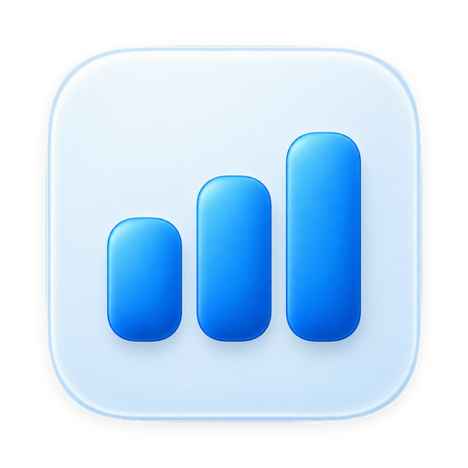
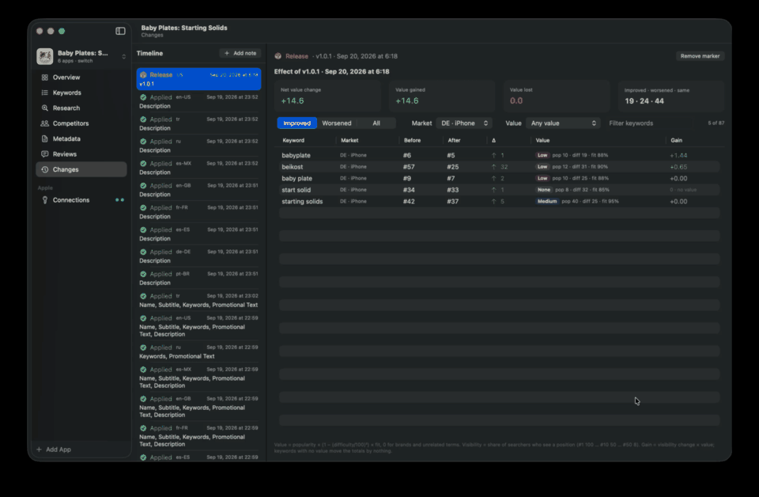

<div align="center">



# ASO Workbench

**Optimización para la App Store en tu Mac, con números honestos.**
Sigue en qué posición aparece tu app, encuentra palabras clave que de verdad puedes ganar, escribe y publica tu ficha en todos los idiomas y comprueba qué efecto tuvo cada cambio.

[](https://github.com/mustafakendiguzel/aso-workbench/releases/latest)


[](LICENSE)

[Instalación](#instalación) · [Inicio rápido](#inicio-rápido) · [Funciones](#qué-hace) · [Claves](#conexiones-qué-claves-y-por-qué) · [Cómo se calculan los números](#cómo-se-calculan-los-números) · [Preguntas frecuentes](#preguntas-frecuentes)

<sub><a href="README.md">English</a> · <a href="README.tr.md">Türkçe</a> · <a href="README.zh-CN.md">简体中文</a> · <a href="README.ja.md">日本語</a> · <a href="README.ko.md">한국어</a> · <b>Español</b> · <a href="README.de.md">Deutsch</a></sub>

</div>

<div align="center">
  <a href="docs/media/demo.mp4"></a>
  <br>
  <sub>▶ <a href="docs/media/demo.mp4"><b>Ver la demo completa</b></a> · la vista previa de arriba no tiene sonido y se repite</sub>
</div>

---

> La interfaz de la app está en inglés. Los nombres de botones y menús de abajo aparecen tal como se ven en la app.

## Por qué ASO Workbench

La mayoría de las herramientas de ASO muestran un único número seguro de sí mismo por palabra clave. A menudo ese número es una suposición, y nadie te dice qué parte viene de Apple y qué parte es de la herramienta.

ASO Workbench toma otro camino:

- **Cada número dice de dónde viene.** La popularidad oficial de Apple, una medición en la búsqueda pública y una estimación del modelo llevan etiquetas distintas y nunca se mezclan.
- **"No encontrado" no es "posición 201".** Ausencia, fallo y "sin comprobar" se guardan por separado.
- **Funciona en tu Mac.** Sin cuenta, sin servidor, sin telemetría. Tus claves se quedan en un solo archivo en tu equipo.
- **Funciona sin ninguna clave** y mejora con cada clave que añades.

## Qué hace

| | |
|---|---|
| 📈 **Seguir** | La posición de cada palabra clave, por país y dispositivo, a partir de búsquedas reales en la App Store (top 200). Gráfico histórico con tus versiones marcadas. Δ frente a tu última versión, para que los avances no desaparezcan al volver a medir. Valoraciones por país y reseñas escritas. |
| 🔎 **Investigar** | Popularidad de Apple donde Apple la publica y una estimación etiquetada en el resto. Dificultad calculada con los diez primeros resultados, explicada por completo. **Palabras clave doradas** (demanda real, competencia superable, no es la marca de otro, relacionada con tu app). Importa las palabras clave de un competidor. Ideas desde el autocompletado. |
| 🌍 **Ir a otros países** | Prueba tus palabras clave en otros países de una sola vez, incluidas formulaciones en el idioma local sugeridas por IA, y sigue las ganadoras con un clic. |
| ✍️ **Escribir** | Un redactor con IA que llena el título, el subtítulo y el campo de palabras clave empezando por las que puedes ganar. *Make better* corrige cada problema de las reglas. Escribe todos los idiomas a la vez, What's New para todos los idiomas y enlaces a Términos y Privacidad añadidos automáticamente. |
| 🚀 **Publicar** | Envía borradores a App Store Connect: se crean los idiomas que faltan, se copian las capturas, se crea la siguiente versión y cada escritura se vuelve a leer. Nunca se envía nada a revisión. |
| 🧪 **Medir** | Una línea de tiempo de versiones y cambios con un informe de antes y después ponderado por el valor de cada palabra clave. Tus resultados de Apple Ads por palabra clave y país. MRR y suscripciones desde RevenueCat. |

## Instalación

### Descarga (lo más fácil)

1. Descarga **`ASO-Workbench-x.y.z.dmg`** desde la [última versión](https://github.com/mustafakendiguzel/aso-workbench/releases/latest).
2. Ábrelo y arrastra **ASO Workbench** a **Aplicaciones**.
3. La primera vez, macOS dice que no puede verificar al desarrollador (la app es gratuita y no está notarizada). Haz clic derecho en la app → **Abrir** → **Abrir**. O bien: Ajustes del Sistema → Privacidad y seguridad → **Abrir igualmente**.

Cuando sale una versión nueva, la app te avisa (abajo en la barra lateral, o **ASO Workbench ▸ Check for Updates…**). Tus datos se copian automáticamente antes de que una versión nueva los abra.

### Compilar desde el código

Necesitas macOS 15 o posterior y Xcode 26 (Swift 6.2). Sin dependencias.

```bash
git clone https://github.com/mustafakendiguzel/aso-workbench.git
cd aso-workbench
make install        # compilación optimizada → /Applications/ASO Workbench.app
```

Después: `make update` descarga el código más reciente y vuelve a instalar. `make help` muestra todos los comandos.

## Inicio rápido

1. **Add App** (abajo en la barra lateral) → pega el enlace de tu app en la App Store. La categoría se rellena sola.
2. **Keywords** → **Add** → escribe las palabras clave que te interesan, una por línea.
3. **Update ▸ Measure all** → las posiciones llegan una a una (unos 3 segundos cada una; Apple limita la búsqueda pública).
4. Opcional: **Connections** → añade la clave de Apple Ads → **Update ▸ Refresh popularity**. Ahora ves la popularidad oficial de Apple.
5. Filters ▸ **Golden** muestra las palabras clave por las que vale la pena luchar. **Metadata ▸ Write** las convierte en una ficha.

## Conexiones: qué claves y por qué

No necesitas ninguna clave para empezar. Cada una desbloquea algo concreto; la pantalla **Connections** de la app explica cada una con instrucciones paso a paso.

| Conexión | Necesidad | Desbloquea | Coste |
|---|---|---|---|
| *(ninguna)* | no hace falta | Posiciones, autocompletado, competidores, dificultad, valoraciones, reseñas | gratis |
| **Apple Ads API** | Recomendada | Popularidad oficial de Apple, resultados de tus campañas | gratis, no gasta nada |
| **App Store Connect API** | Opcional | Descargar y publicar tu ficha en todos los idiomas | gratis |
| **OpenRouter** | Opcional | Redactor con IA, traducciones, comprobación de marca y relevancia, estimaciones de popularidad | pago por uso, fracciones de céntimo |
| **RevenueCat** | Opcional | MRR y suscripciones en Overview | gratis |
| **Sesión web de Apple Ads** | Avanzada | El índice exacto de Apple para términos que no están en las listas (no documentado, bajo tu responsabilidad) | gratis |

Las claves viven en un solo archivo en tu Mac, que solo tú puedes leer, y cada clave va únicamente a su propio servicio. Detalles y cómo conseguir cada clave: **[docs/CONNECTIONS.md](docs/CONNECTIONS.md)** (en inglés).

## Cómo se calculan los números

### Los números, explicados de forma sencilla

| Número | Significado sencillo | Mejor si es |
|---|---|---|
| **Rank** (posición) | Dónde aparece tu app cuando alguien busca esta palabra. | baja (#1 es lo mejor) |
| **Popularity** (5–100) | Cuánta gente busca esta palabra, en la escala de Apple. | alta |
| **Difficulty** (0–100) | Lo difícil que es llegar a la primera página, según lo grandes y enfocadas que sean las apps que ya están ahí. | baja |
| **Opportunity** (oportunidad) | La popularidad descontada por la dificultad: popularidad × (1 − (dificultad ÷ 100)²). | alta |
| **Fit** (encaje) | La probabilidad de que quien busca esto quiera una app como la tuya. | relacionada (≥ 50%) |
| **Golden ★** | Popularidad ≥ 30, dificultad ≤ 45, no es una marca, relacionada con tu app. | ★ |

### Popularidad: primero Apple, después la estimación

Apple publica una popularidad de 1 a 100 solo para lo más alto de cada categoría (listas mensuales) y, desde el 29 de septiembre de 2025, informa **5** para todo lo que queda por debajo. ASO Workbench muestra, en este orden:

1. **El valor de la lista de Apple** (etiqueta `Apple`, necesita la clave de Apple Ads),
2. **El índice exacto de Apple** (etiqueta `Apple · index`, sesión web opcional),
3. **Una estimación del modelo** (etiqueta `Derived · est.`) y, para el "5" de Apple, una **posición de 6 a 29 entre los términos del suelo** para que aún puedas compararlos,
4. si no, **"< N"**: por debajo de la puntuación más baja de las listas.

La estimación viene de un modelo que entrenamos nosotros mismos y que va dentro de la app:

1. **Datos.** Unos 55.800 términos de búsqueda de cinco países (US, GB, DE, FR, TR).
2. **Respuestas correctas.** Cada término está etiquetado con la popularidad real de Apple.
3. **Pistas.** Cada término se describe solo con pistas públicas: autocompletado, resultados de búsqueda y **Jev**. Jev (TypeSafe Jev, un pequeño modelo de clasificación al que se accede mediante OpenRouter) responde preguntas concretas con probabilidades, como "¿es una marca?", "¿suena a demanda real?" y "¿de qué categoría es?".
4. **Entrenamiento.** Dos pequeños modelos de CreateML aprendieron a predecir el número de Apple a partir de esas pistas. Vienen con la app, así que tú nunca tienes que entrenar nada.

Durante el uso, Jev responde las mismas preguntas para tus términos nuevos, por eso la estimación necesita la clave de OpenRouter. Con términos que nunca vio, el modelo los ordena igual que Apple con una correlación de **0,74** y se desvía unos **10 puntos** en un término típico. Es una ayuda para ordenar, siempre está etiquetada y el número de Apple siempre gana. **[El método completo y los resultados de las pruebas →](docs/POPULARITY.md#the-model-step-by-step)** (en inglés)

### Dificultad

Se calcula con los **diez primeros** resultados públicos, los que un usuario realmente ve. Pondera lo grandes que son los tres primeros (35%), lo grande que es el resto de la primera página (20%), cuántos incluyen la palabra clave en su título (20%), lo consolidados (10%), lo activamente actualizados (10%) y lo bien valorados (5%) que están, con un descuento cuando Apple llena la página con apps poco relacionadas. El panel de detalle de la palabra clave muestra cada parte. **[Detalles →](docs/POPULARITY.md#difficulty)**

### Antes y después

Cada versión (detectada automáticamente), cada cambio que publicas y cada nota que añades se convierten en un marcador. La página **Changes** compara las posiciones antes y después, ponderadas por el valor de cada palabra clave. Subir 50 puestos en un término que nadie busca no vale nada.

## Privacidad y seguridad

- Funciona en local. No hay servidor de ASO Workbench, ni cuenta, ni analítica.
- La app solo se comunica con una lista permitida de servidores (Apple, OpenRouter, RevenueCat y GitHub para buscar actualizaciones). Consulta la [lista completa](SECURITY.md).
- No se escribe nada en App Store Connect sin tu confirmación; cada escritura se vuelve a leer; nunca se envía nada a revisión.
- Claves: `~/Library/Application Support/ASO Workbench/credentials.json` (permisos 600). Datos: `store.sqlite` en la misma carpeta, un archivo SQLite normal que puedes copiar o borrar.

Consulta **[SECURITY.md](SECURITY.md)**.

## Estructura del proyecto

```
Sources/
├── ASOCore/        lógica pura: modelos, reglas, dificultad, diferencias, características (sin red, sin interfaz)
├── ASOProviders/   adaptadores de Apple, OpenRouter y RevenueCat tras un cliente HTTP con lista permitida
└── ASOWorkbench/   la app SwiftUI: pantallas, servicios, modelo SwiftData, sistema de diseño
Resources/          Info.plist, icono, modelo de popularidad incluido
scripts/            bundle-app.sh (compila la .app), release.sh (.dmg y versión en GitHub)
docs/               POPULARITY, CONNECTIONS, ARCHITECTURE, RELEASING
```

Tres capas que el compilador mantiene separadas, concurrencia estricta de Swift 6 y cero dependencias. **[Arquitectura →](docs/ARCHITECTURE.md)** (en inglés)

## Desarrollo

```bash
make open      # compilación de depuración y arranque
make test      # pruebas unitarias
make lab       # arranca con el Lab para desarrolladores (reentrenar el modelo de popularidad)
make dist      # genera el .dmg y el .zip de una versión (mantenedores)
```

Versiones, numeración y cómo llegan las actualizaciones a los usuarios: **[docs/RELEASING.md](docs/RELEASING.md)**. Contribuciones: **[CONTRIBUTING.md](CONTRIBUTING.md)**. Cambios: **[CHANGELOG.md](CHANGELOG.md)**.

## Preguntas frecuentes

**¿Por qué mis números no coinciden con los de otras herramientas de ASO?**
Porque Apple publica muy poco por debajo de lo más alto de cada categoría, y otras herramientas rellenan el hueco con sus propias estimaciones, normalmente sin decirlo. ASO Workbench muestra el valor de Apple cuando Apple tiene uno y etiqueta todo lo demás.

**¿Conectar Apple Ads cuesta dinero?**
No. Los servicios de popularidad y de informes son de solo lectura y no necesitan ninguna campaña activa.

**¿Puede estropear mi ficha de la App Store?**
Solo escribe cuando pulsas Apply y confirmas, se niega si la ficha cambió desde la última vez que la descargaste, vuelve a leer después de escribir y nunca envía nada a revisión.

**¿Por qué macOS 15?**
Usa SwiftData, el inspector de SwiftUI y funciones de Swift 6 que necesitan macOS 15.

**¿Dónde están mis datos? ¿Cómo empiezo de cero?**
En `~/Library/Application Support/ASO Workbench/`. Cierra la app y borra `store.sqlite` para empezar de cero; borra `credentials.json` para eliminar todas las claves.

## Licencia

**Gratis para usar, no para vender.** Licencia MIT con la Commons Clause: puedes usar ASO Workbench gratis (también para tus propias apps comerciales), leer y cambiar el código y compartirlo con esta licencia adjunta. No puedes venderlo, ni una copia modificada, ni un servicio de pago construido principalmente sobre él. Consulta [LICENSE](LICENSE).

ASO Workbench no está afiliado a Apple ni cuenta con su respaldo. App Store, Apple Ads y App Store Connect son marcas comerciales de Apple Inc.

<div align="center"><sub><a href="README.md">English</a> · <a href="README.tr.md">Türkçe</a> · <a href="README.zh-CN.md">简体中文</a> · <a href="README.ja.md">日本語</a> · <a href="README.ko.md">한국어</a> · <b>Español</b> · <a href="README.de.md">Deutsch</a></sub></div>
